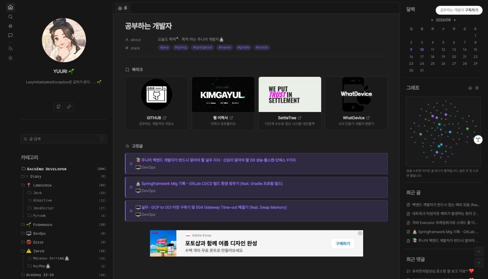
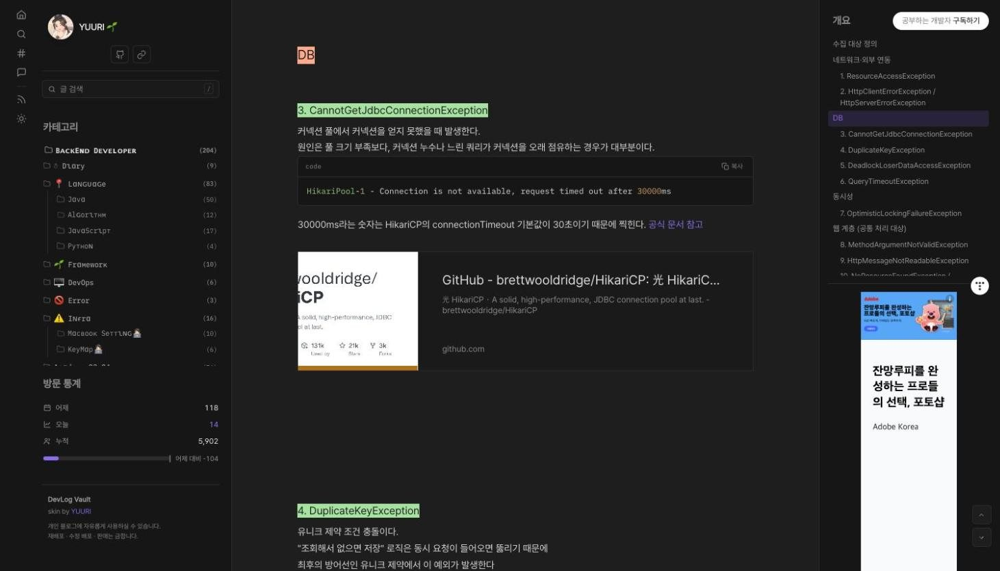
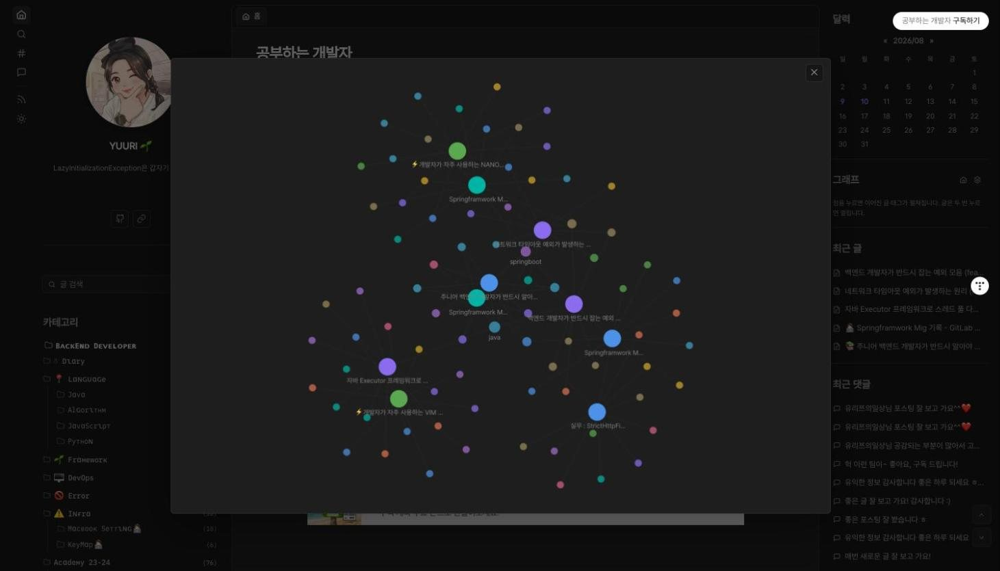
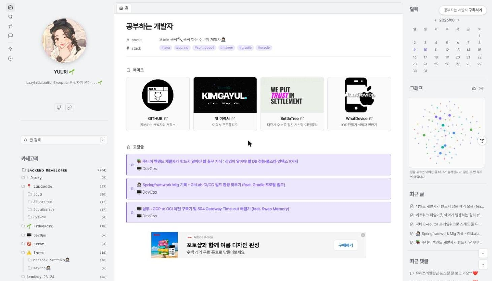
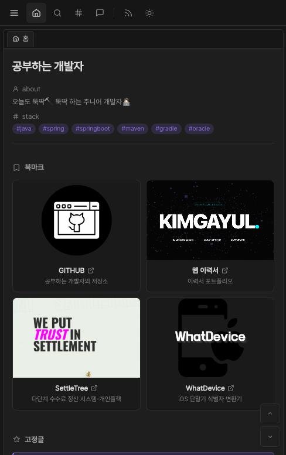
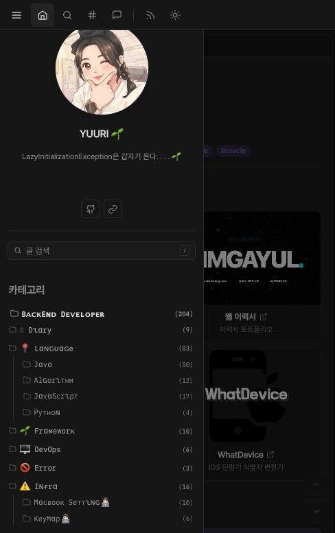

<div align="center">

# DevLog Vault

옵시디언(Obsidian)처럼 생긴 티스토리 스킨입니다.

왼쪽은 파일 탐색기 같은 카테고리, 가운데는 글, 오른쪽은 달력과 개요.
개발 블로그 쓰다가 "옵시디언에서 글 쓰던 그 화면이었으면" 싶어서 만들었습니다.


<a href="https://github.com/gayulz/DevLog_Vault/stargazers"></a>



<table align="center">
<tr><td align="center" width="620">

&nbsp;

🌱 &nbsp; **0원입니다.** 개인 블로그라면 누구든 그냥 가져다 쓰세요

🎨 &nbsp; 색이든 서체든 **내 블로그에 맞게 고쳐 쓰는 것도 자유**예요

🙅 &nbsp; 다만 **재수정 배포 · 재배포 · 유료 판매는 안 됩니다**

⭐ &nbsp; 쓰다가 좋으셨다면 **Star** 하나만요. 그게 다음 버전 만드는 힘이 됩니다

&nbsp;

</td></tr>
</table>

</div>

---

## 목차

- [어떻게 생겼나](#어떻게-생겼나)
- [설치](#설치)
- [화면이 폭에 따라 바뀝니다](#화면이-폭에-따라-바뀝니다)
- [스킨 편집 옵션](#스킨-편집-옵션)
- [글 쓸 때 알아두면 좋은 것](#글-쓸-때-알아두면-좋은-것)
- [광고·분석 코드 넣기](#광고분석-코드-넣기)
- [자주 묻는 것](#자주-묻는-것)
- [라이선스](#라이선스)

---

## 어떻게 생겼나

### 글 읽는 화면



왼쪽 사이드바는 스크롤을 내려도 화면에 붙어 있습니다. 프로필이 접히면서 그 자리를
카테고리가 가져가기 때문에, 글을 한참 내려도 왼쪽이 텅 비지 않아요.
오른쪽 개요는 지금 읽는 위치를 따라옵니다. 코드블록에는 언어 이름과 복사 버튼이 붙습니다.

### 태그 그래프



블로그 RSS를 읽어서 글과 태그가 어떻게 얽혀 있는지 그립니다. 점을 누르면 이어진 것들이
펼쳐지고, 글은 두 번 누르면 열려요. 외부 라이브러리 없이 canvas로만 그립니다.

### 라이트 모드



왼쪽 리본의 달/해 아이콘으로 바꿉니다. 고른 테마는 브라우저가 기억해요.

### 모바일

<table>
<tr>
<td width="50%"></td>
<td width="50%"></td>
</tr>
</table>

리본이 상단 바로 바뀌고, 왼쪽 사이드바는 ☰ 버튼을 누르면 서랍으로 나옵니다.

### 그 밖에

카테고리 트리는 고정폭 서체로 맞춰서 한글까지 세로줄이 딱 떨어집니다. 홈 상단에는 링크
카드를 **여덟 장까지** 놓는데, HTML 손댈 필요 없이 스킨 편집에서 설정해요. 고정글은 티스토리
"공지"를 그대로 쓰거나, 글 주소만 넣으면 제목과 카테고리를 알아서 읽어옵니다.

- 표 — 머리글 배경과 줄무늬로 줄 구분, 넘치는 표는 가로 스크롤 안내, 선택한 표는 모바일 카드로 표시
- 제목 형광펜 — h1 노랑, h2 살구, h3 연두
- 본문 명암비 — WCAG AA 4.5:1 기준
- 외부 JS 라이브러리 없음 — 불러오는 건 서체와 `script.js` 하나뿐

---

## 설치

### 1. 파일 올리기

관리자 → 꾸미기 → 스킨 편집 → html 편집 으로 들어갑니다.

| 탭 | 할 일 |
|---|---|
| HTML | `skin.html` 전체를 붙여넣기 |
| CSS | `style.css` 전체를 붙여넣기 |
| 파일업로드 | `images/script.js` 올리기 |

붙여넣고 적용을 누르면 끝입니다. `index.xml`은 이 방법에서는 쓰지 않아요.

**v3.10.4에서 v3.10.5로 업데이트할 때는 CSS 탭의 `style.css`와 파일업로드의
`images/script.js`를 교체하세요.** 에디터에서 가운데·오른쪽 정렬한 제목이 발행 화면에서
왼쪽에 붙던 문제를 고쳤습니다. 기존 글을 다시 저장할 필요는 없습니다. 스킨 옵션은
바뀌지 않았으므로 `index.xml`을 다시 등록하지 마세요.

업로드 뒤에는 **현재 HTML을 백업하고, HTML 탭 맨 끝에 빈 줄 한 개만 추가한 뒤 적용**을
누르세요. 티스토리는 JS만 덮어쓰면 공개 페이지의 파일 버전(`?_version_=`)이 그대로 남아
브라우저가 이전 JS를 계속 쓸 수 있습니다. HTML을 적용해 파일 버전을 갱신한 뒤 페이지를
새로고침하세요. 개인 광고 코드가 있는 HTML 전체를 배포용 파일로 덮어쓰면 안 됩니다.

**v3.10.2 이하에서 업데이트한다면 `style.css`도 교체하고, v3.10.3에 추가된 아래 HTML
조각도 반영하세요.** 현재 HTML을 먼저 백업하고, 광고 폭 조절 코드를 기존 `<head>` 바로
다음에 한 번 넣으세요. `id="dv-ad-layout"` 코드가 이미 있다면 중복으로 넣지 마세요.
개인 광고·분석·인증 코드가 들어 있는 HTML 전체를
배포용 `skin.html`로 덮어쓰지 마세요. 스킨 옵션은 바뀌지 않아 `index.xml`을 다시 등록할
필요가 없습니다.

```html
<script id="dv-ad-layout">
  /* 반응형 광고가 요청되기 전에 화면 전체 폭 확장을 끈다. */
  (function () {
    var selector = 'ins.adsbygoogle[data-ad-format="auto"]:not([data-adsbygoogle-status])';
    function fit(ad) { ad.setAttribute('data-full-width-responsive', 'false'); }
    var observer = new MutationObserver(function (records) {
      records.forEach(function (record) {
        record.addedNodes.forEach(function (node) {
          if (node.nodeType !== 1) return;
          if (node.matches(selector)) fit(node);
          node.querySelectorAll(selector).forEach(fit);
        });
      });
    });
    observer.observe(document.documentElement, { childList: true, subtree: true });
    document.addEventListener('DOMContentLoaded', function () { observer.disconnect(); });
  })();
</script>
```

처음 설치할 때는 이 코드가 포함된 `skin.html`을 사용하면 됩니다.

<details>
<summary>zip으로 "스킨 등록"을 하고 싶다면</summary>

관리자 → 꾸미기 → 스킨 변경 → 스킨 등록 에 아래 파일을 묶어서 올립니다.

```
skin.html
style.css
index.xml
images/script.js
preview.gif        (112×84)
preview256.jpg     (256×192)
preview560.jpg     (560×420)
preview1600.jpg    (1600×1200)
```

저장소를 받은 폴더에서 아래를 실행하면 필요한 파일만 담긴 zip이 나옵니다.

```bash
python3 build_release.py
# → dist/DevLog-Vault-v3.10.5.zip
```

다만 이미 쓰고 있는 스킨을 업데이트하는 거라면 이 방법은 피하세요.
`index.xml`이 같이 올라가면서 스킨 편집에 저장해 둔 값(북마크 주소 같은 것)이
초기화될 수 있습니다. 그럴 때는 위 업데이트 방법에 따라 CSS·JS를 교체하고,
현재 HTML에 필요한 부분만 추가하세요.

</details>

### 2. 모바일웹 자동 연결 끄기

이걸 안 끄면 휴대폰에서 스킨이 적용되지 않습니다. 티스토리가 기본 모바일 스킨을
대신 보여 주거든요. 설치하고 나서 "왜 폰에서는 그대로지?" 하는 경우가 대부분 이것 때문입니다.

> 관리자 → 꾸미기 → 모바일 → **모바일웹 자동 연결**을 **사용하지 않음**으로

`내블로그주소/m`에 들어갔을 때 이 스킨이 보이면 제대로 꺼진 겁니다.

### 3. 사이드바 위젯 순서 맞추기

관리자 → 꾸미기 → 사이드바 에서 아래 순서로 배치해 주세요.
순서가 다르면 카테고리나 달력이 엉뚱한 자리에 나옵니다.

| 사이드바 1 (왼쪽) | 사이드바 2 (오른쪽) |
|---|---|
| 1. 프로필 | 1. 달력 |
| 2. 검색 | 2. 최근 글 |
| 3. 카테고리 | 3. 인기 글 |
| 4. 방문 통계 | 4. 최근 댓글 |

메뉴바와 구독 버튼은 오른쪽 상단만 피해 주세요. 스킨의 탭 바와 겹칩니다.

---

## 화면이 폭에 따라 바뀝니다

| 폭 | 배치 |
|---|---|
| 1501px~ | 리본 + 왼쪽 사이드바 + 본문 + 오른쪽 사이드바 |
| 1181~1500px | 왼쪽 사이드바를 조금 줄인 4열 |
| 1001~1180px | 오른쪽 사이드바(달력·그래프·개요)를 접은 3열 |
| 761~1000px | 왼쪽 사이드바가 서랍으로 |
| ~760px | 모바일 |

모바일에서는 오른쪽 사이드바 내용(달력·최근 글·인기 글·최근 댓글)이 본문 아래로 내려와
카드로 쌓입니다. 그래프와 개요는 접습니다. 그래프는 손가락 드래그가 페이지 스크롤과
겹치고, 개요는 이미 지나온 글을 다시 가리키니까요. 아이폰 노치와 홈 인디케이터
영역도 피해서 여백을 잡습니다.

---

## 스킨 편집 옵션

관리자 → 꾸미기 → 스킨 편집 오른쪽 패널에서 설정합니다. HTML을 고칠 일은 없습니다.

### 디자인

| 옵션 | 형식 | 기본값 | 설명 |
|---|---|---|---|
| 강조 색상 | 색 | `#8b6cef` | 링크, 태그, 현재 페이지 같은 포인트 색 |
| 본문 배경 (다크) | 색 | `#1e1e1e` | 다크 모드 글 영역 배경 |
| 사이드바 배경 (다크) | 색 | `#161616` | 다크 모드 좌우 사이드바 배경 |

라이트 모드 색은 스킨이 알아서 맞춥니다. 비워 두면 기본값이 그대로 쓰여요.

### 홈 — 소개, 기술 스택

| 옵션 | 형식 | 설명 |
|---|---|---|
| about 한 줄 소개 | 글 | 홈 제목 아래 `about` 줄. 비우면 줄 자체가 안 나옵니다 |
| 태그 1~6 | 글 | `stack` 줄에 나올 태그. 실제로 있는 태그명을 적으세요. 없는 태그는 404입니다 |

### 홈 — 본문 글 목록

| 옵션 | 기본값 | 설명 |
|---|---|---|
| 최근 글 목록 표시 | 켬 | 끄면 홈에서 글 목록과 페이지 번호가 사라집니다 |
| 인기 글 목록 표시 | 켬 | |
| 인기 글 개수 | 5 | 1~10 |
| 인기 글을 위에 | 켬 | 끄면 최근 글이 위로 올라갑니다 |

### 홈 — 고정글

| 옵션 | 기본값 | 설명 |
|---|---|---|
| 고정글 표시 | 켬 | |
| 고정글 개수 | 3 | 티스토리 "공지"로 등록한 글 중 몇 개를 보여줄지 |
| 고정글 1~3 · 글 주소 | — | 주소만 넣으면 제목과 카테고리를 자동으로 읽어옵니다 |

직접 지정한 고정글이 먼저 나오고, 그 뒤에 "공지"로 등록한 글이 이어집니다.

### 북마크 1~8

홈 상단의 링크 카드입니다. 한 줄에 네 장씩, 최대 여덟 장(두 줄)까지 놓입니다.
카드마다 아래 값을 설정합니다.

| 옵션 | 형식 | 설명 |
|---|---|---|
| 이 북마크 사용 | 켬/끔 | 꺼져 있으면 카드가 안 나옵니다 |
| 제목 / 부제목 | 글 | |
| 링크 주소 | 글 | 비우면 카드가 안 나옵니다 |
| 이미지 | 이미지 | 카드 전체를 채웁니다. 안 고르면 배경색 위에 제목 글자만 나옵니다 |
| 배경색 | 색 | 이미지가 없을 때 쓰입니다 |

이미지는 카드를 꽉 채우고 제목·부제목이 그 위에 얹힙니다. 글자가 놓이는 자리만 아래로 갈수록
어두워지므로 밝은 이미지를 넣어도 글자가 읽힙니다. 카드 비율이 **4:3** 이라 가로가 긴 이미지는
좌우가 잘리니(가운데 기준), 글자가 든 이미지라면 글자를 가운데에 두세요. 800×600 정도면 충분합니다.

여덟 장을 모두 비우면 북마크 영역 자체가 사라집니다. 세 장만 켜면 왼쪽부터 세 장이 놓이고
오른쪽은 비워 둡니다. 다섯 장 이상 켜면 모바일에서 카드를 조금 촘촘하게 그려서
홈이 너무 길어지지 않게 합니다.

### 태그 그래프

| 옵션 | 기본값 |
|---|---|
| 그래프 표시 | 켬 |

드래그로 옮기고 휠로 확대합니다. 우상단 버튼으로 크게 볼 수 있어요.
정상적으로 읽은 결과는 브라우저에 최대 하루 동안 저장해 다음 화면에서 먼저 보여 줍니다.
저장된 결과가 있어도 그래프를 처음 표시할 때 RSS를 다시 확인하고, 글·태그가 달라졌을 때만
그래프를 새로 그립니다. 빈 결과·잘못된 결과·하루가 지난 결과는 저장소에서 자동으로 지웁니다.
태그를 하나도 안 쓰는 블로그라면 그릴 게 없으니 안내 문구만 나옵니다.

**그래프에 글이 몇 개 나오는지는 스킨이 아니라 RSS 설정이 정합니다.** 티스토리
관리 > 블로그 에서 RSS 공개 개수를 올리면(최대 50) 그만큼 더 그려집니다. 기본값 10이면
최근 글 10개만 나와요. 같은 화면에서 RSS를 **부분공개**로 바꾸면 본문이 요약으로 바뀌어
글 50개짜리 RSS가 450KB에서 70KB 안팎까지 줄어듭니다. 그래프가 쓰는 제목·링크·태그는
그대로 남으니 그래프에는 손해가 없습니다(RSS 구독자는 본문 대신 요약을 받게 됩니다).

그래프는 **화면에 들어올 때** 읽습니다. 글만 읽고 내려가지 않는 방문자는 RSS를 아예
받지 않고, 그래프를 숨기는 좁은 화면에서도 받지 않습니다.

다른 탭에 갔다가 돌아오면 마지막 확인에서 **60초 이상** 지났고 그래프가 화면에 보이는
경우에만 RSS를 다시 확인합니다. 주기적으로 요청하지 않으며, 이미 확인 중일 때는 요청을
겹쳐 보내지 않습니다. 네트워크나 RSS 형식 오류로 읽지 못하면 기존 정상 그래프를 유지합니다.
정상 RSS의 글 목록이 비었다면 이전 RSS 데이터와 저장 결과를 지웁니다. 현재 읽는 글의
태그를 표시하는 동작은 그대로입니다.

### 저작권, 콘텐츠 보호

| 옵션 | 기본값 | 설명 |
|---|---|---|
| 글 아래 저작권 문구 | — | 본문 아래 회색 상자로 표시. 줄바꿈이 그대로 살아납니다 |
| 복사할 때 출처 붙이기 | 켬 | 본문을 복사하면 끝에 글 주소가 붙습니다 |
| 우클릭·드래그 막기 | 끔 | 코드블록은 예외라 코드는 복사됩니다 |

콘텐츠 보호는 완전한 차단이 아닙니다. 개발자도구나 소스보기, 인쇄로 다 우회돼요.
가벼운 방지턱 정도로 생각해 주세요.

### 사이트 정보 (개인정보처리방침 · 문의)

| 옵션 | 기본값 | 설명 |
|---|---|---|
| 개인정보처리방침 글 주소 | — | 예) `/privacy` · 비워두면 링크가 나오지 않습니다 |
| 문의 글 주소 | — | 예) `/contact` · 비워두면 링크가 나오지 않습니다 |

넣은 주소가 왼쪽 사이드바 맨 아래, 스킨 표기 위에 작은 링크로 붙습니다.
둘 다 비워두면 그 줄 자체가 사라져요.

**광고를 붙이실 생각이라면 개인정보처리방침은 선택이 아니라 필수입니다.**
구글 애드센스는 이 페이지가 없으면 심사에서 막고, 승인된 뒤에도 정책 위반으로 광고를 중지할 수 있습니다.

두 글의 본문을 처음부터 쓰기는 번거로우니 템플릿을 넣어 뒀습니다.
[docs/privacy-contact-template.md](docs/privacy-contact-template.md) 에서 그대로 복사해다 쓰시고,
이메일과 블로그 이름 같은 `[ ]` 표시된 자리만 본인 것으로 바꾸시면 됩니다.

옵션에는 **실제로 발행된 글의 주소**를 넣으시면 됩니다.
티스토리 기본값인 숫자 주소라면 `/123` 처럼, 문자 주소를 쓰신다면 `/privacy` 처럼 적으세요.
숫자 주소라고 문제될 것은 없습니다 — 애드센스도 주소 모양은 보지 않아요.
글을 먼저 발행하고 그 주소를 넣는 순서면 됩니다.

### 사이드바 — 글 목록

| 옵션 | 기본값 |
|---|---|
| 최근 글 표시 / 개수 | 켬 / 5 |
| 인기 글 표시 / 개수 | 끔 / 5 |
| 최근 댓글 표시 / 개수 | 켬 / 5 |

글을 읽는 화면에서는 이 세 목록이 자동으로 접힙니다. 개요가 화면에 붙어 따라다니는데
그 아래 목록까지 남아 있으면 글자가 겹치거든요.

---

## 글 쓸 때 알아두면 좋은 것

### 제목 형광펜

본문의 h1은 노랑, h2는 살구, h3은 연두로 칠해집니다. 화면에 들어올 때 왼쪽에서
오른쪽으로 그어지는 효과가 붙어요. 시스템에서 "동작 줄이기"를 켜 두었다면 효과 없이
처음부터 칠해진 상태로 나옵니다.

에디터에서 지정한 왼쪽·가운데·오른쪽 정렬을 제목에도 반영합니다. 부모 요소에서
상속한 정렬도 따르며, 양끝 정렬 제목은 본문 폭을 사용합니다. 정렬 보정은 스킨의
`script.js`가 실행될 때 적용됩니다.

### 표

에디터에서 표를 넣으면 스킨이 알아서 정리합니다. 머리글을 켜서 넣은 표는 첫 줄에
배경색이 들어가고, 머리글 없이 넣은 표는 줄무늬와 테두리로 줄을 나눕니다.
칸이 3개 이상이면 좁은 화면에서 가로로 밀어서 볼 수 있어요. 실제로 표가 본문 폭을
넘칠 때만 **"표를 좌우로 밀어 전체 내용을 확인하세요"** 안내가 나옵니다.
키보드로는 Tab 키로 표 영역에 이동한 뒤 좌우 방향키로 넘길 수 있습니다.
에디터가 셀에 몰래 넣어 두는 흰 배경도 걷어내기 때문에 다크 모드에서 어색하지 않습니다.

매장 목록처럼 한 행이 한 항목인 표는 모바일에서 카드로 바꿀 수 있습니다.
글 편집기의 HTML 모드에서 **해당 `<table>`에만 `data-mobile-cards="true"`를 추가**하세요.
첫 행은 각 열의 이름, 첫 열은 항목 이름으로 사용합니다.

```html
<table data-mobile-cards="true">
  <thead>
    <tr><th>매장 이름</th><th>주소</th><th>연락처</th></tr>
  </thead>
  <tbody>
    <tr><td>예시 매장</td><td>서울시 예시로 1</td><td>02-000-0000</td></tr>
  </tbody>
</table>
```

화면 폭이 **760px 이하**이면 각 행이 카드가 되어 항목 이름 아래에 주소·연락처처럼
열 이름과 내용이 함께 표시됩니다. 761px 이상에서는 원래 표로 보입니다.
첫 행이 실제 머리글이고 모든 행의 열 개수가 같은 단순한 표에 사용하세요.
셀 병합(`colspan`·`rowspan`), 중첩 표, 여러 줄 머리글, 표 하단글(`tfoot`)이 있는 표는
자동 변환하지 않고 가로 스크롤을 유지합니다. 속성을 추가하지 않은 기존 표도 그대로입니다.

골프존·네이버처럼 짧은 링크 두 개를 카드 아래 좌우 버튼으로 놓으려면
**`data-mobile-actions="4,5"`도 추가**하세요. 숫자는 첫 열부터 센 링크 열의 위치입니다.
각 버튼에는 원래 아이콘과 해당 열 이름이 함께 표시되며, 누를 수 있는 높이는 최소 44px입니다.

```html
<table data-mobile-cards="true" data-mobile-actions="4,5">
  <thead>
    <tr><th>매장 이름</th><th>주소</th><th>연락처</th><th>골프존</th><th>네이버</th></tr>
  </thead>
  <tbody>
    <tr>
      <td>예시 매장</td><td>서울시 예시로 1</td><td>02-000-0000</td>
      <td><a href="https://example.com/golfzon">G</a></td>
      <td><a href="https://example.com/naver">N</a></td>
    </tr>
  </tbody>
</table>
```

첫 열을 제외한 서로 다른 두 열을 지정하고, 모든 데이터 행의 해당 셀에 링크가 하나씩
있어야 합니다. 조건이 맞지 않으면 일반 카드 배치를 유지합니다. 이 속성도 모바일에만
적용되므로 PC에서는 원래 표와 링크가 그대로 보입니다.

### 복사해 붙여넣은 글

다른 사이트에서 글을 복사해 오면 그쪽 글자색과 투명도가 딸려옵니다. 그대로 두면
글이 배경에 묻혀서 안 보이는 일이 생겨요. 스킨이 본문을 훑어서 거의 투명한 요소를
되살리고, 배경 대비가 부족한 글자는 읽히는 색으로 바꿉니다. 이미 잘 보이는 글자는
건드리지 않아요. 따로 설정할 건 없습니다.

형광펜(배경색)을 칠한 글자도 배경 밝기를 재서 진한 글자와 밝은 글자 중에 골라 넣습니다.

### 방문 통계

티스토리가 스킨에 주는 값은 어제·오늘·누적 세 개뿐입니다. 그래서 일자별 그래프는
만들 수 없고, 대신 "어제 대비 오늘" 추이 막대를 그립니다.

---

## 광고·분석 코드 넣기

티스토리 옵션 입력칸에는 `<script>`를 넣을 수 없습니다. 저장할 때 걸러지거든요.
그래서 `skin.html` 안에 표시해 둔 자리에 직접 붙여넣는 방식입니다.

`skin.html`을 열면 아래 주석이 보입니다. 그 사이에 코드를 넣으세요.

| 자리 | `skin.html` 안의 표시 | 넣는 것 |
|---|---|---|
| `<head>` | `▼▼▼ 광고 · 분석 · 사이트 인증 코드를 여기에 붙여넣으세요 ▼▼▼` | 애드센스, GTM(head 쪽), 사이트 인증, GA4 |
| `<body>` 직후 | `▼ 구글 태그 매니저의 "<body>" 쪽 코드 ▼` | GTM `<noscript>` |
| 목록 상단 | `▼▼▼ 목록 상단 광고 자리 ▼▼▼` | 728×90 권장. 글 페이지에서는 자동으로 숨습니다 |
| 글 본문 아래 | `▼▼▼ 글 본문 아래 광고 자리 ▼▼▼` | 728×90 또는 300×250 |
| 사이드바 (PC) | `▼▼▼ 사이드바 광고 자리 ▼▼▼` | 250×250 또는 160×600 |
| 사이드바 (모바일) | `▼▼▼ 모바일 전용 사이드 광고 자리 ▼▼▼` | 250×250 정사각형 권장 |

코드를 안 넣으면 그 자리는 아예 사라집니다. 빈 여백이 남지 않아요.

### 사이드바는 자리가 두 개입니다

PC용 자리는 글 본문에서 개요 바로 아래, 홈이나 목록에서는 맨 아래(최근 댓글 다음)에
놓입니다. 모바일용 자리는 달력 바로 아래에 나오고요. 서로 반대편에서는 숨습니다.
세로로 긴 배너가 모바일 화면을 너무 많이 차지해서 이렇게 나눠 뒀습니다.

카카오 애드핏을 쓴다면 PC용과 모바일용 광고 단위를 따로 만들어서 각 자리에 넣으세요.
로더 스크립트(`ba.min.js`)는 페이지에 한 번만 있으면 두 자리를 모두 처리합니다.

고정 크기 광고를 CSS로 늘리거나 줄이지 마세요. 자리에 맞는 광고 단위를 선택하세요.
오른쪽 사이드바 안쪽 폭은 256px이라 250×250이 딱 들어갑니다.

### 모바일에서 본문 구글 광고가 옆으로 넘칠 때

반응형 애드센스 광고는 휴대폰에서 화면 전체 폭으로 확장될 수 있습니다. v3.10.3은
페이지의 HTML을 해석하는 동안 추가되는 `data-ad-format="auto"` 광고에 요청 전에
`data-full-width-responsive="false"`를 설정해 본문 폭을 기준으로 크기를 정하게 합니다.
이미 요청된 광고나 고정 크기 광고의 내부 프레임을 CSS로 강제로 줄이지 않습니다.
HTML 해석이 끝난 뒤 동적으로 추가되는 자동 광고는 이 초기 설정의 대상이 아닙니다.
이 설정은 [구글의 반응형 광고 코드 안내](https://support.google.com/adsense/answer/9183460?hl=en)에
설명된 속성을 사용합니다.

v3.10.2 이하의 기존 사용자는 [설치의 업데이트 안내](#1-파일-올리기)에 있는 HTML 조각도
반영해야 합니다. CSS·JS만 바꾸면 요청 전 설정이 추가되지 않습니다.

### 업데이트하면 광고 코드가 지워집니다

`skin.html`을 새 버전으로 갈아끼우면 붙여넣었던 코드가 같이 사라집니다.
덮어쓰기 전에 지금 쓰는 `skin.html`을 따로 저장해 두세요.

자주 업데이트한다면 광고 코드 조각을 파일로 빼 두고 새 `skin.html`에 자동으로 끼워 넣는
스크립트를 만들어 두면 편합니다. 방법은
[docs/DEVELOPING.md](docs/DEVELOPING.md#배포용--개인용-두-벌로-관리하기)에 적어 뒀습니다.

---

## 자주 묻는 것

<details>
<summary>휴대폰에서 스킨이 적용이 안 돼요</summary>

관리자 → 꾸미기 → 모바일 → 모바일웹 자동 연결이 켜져 있으면 휴대폰에는 티스토리
기본 모바일 스킨이 나옵니다. 이걸 꺼 주세요. ([설치 2번](#2-모바일웹-자동-연결-끄기))

</details>

<details>
<summary>카테고리나 달력이 엉뚱한 자리에 나와요</summary>

사이드바 위젯 순서 문제입니다. 이 스킨은 왼쪽 4칸(프로필/검색/카테고리/방문통계),
오른쪽 4칸(달력/최근글/인기글/최근댓글)을 씁니다. ([설치 3번](#3-사이드바-위젯-순서-맞추기))

</details>

<details>
<summary>최근 댓글이 안 보여요</summary>

표시를 켰는데 목록이 비어 있으면 "아직 등록된 댓글이 없어요" 문구가 나옵니다.
그 문구조차 안 보인다면 사이드바 위젯이 스킨의 칸 수만큼 배치돼 있는지 확인해 주세요.

</details>

<details>
<summary>새로고침하면 광고 자리가 프로필 위에 잠깐 보였다 사라져요</summary>

구글 자동 광고가 페이지를 훑으면서 광고 자리를 먼저 잡아 두고, 채울 광고가 없으면
그 자리를 없애기 때문입니다. 스킨 문제가 아닙니다.

사이드바에 광고가 끼어들어도 프로필·검색·카테고리가 항상 먼저 오도록 순서를 고정해
두어서 화면이 튀지는 않습니다. 사이드바에 광고를 아예 안 띄우고 싶다면 `style.css`의
`.side .google-auto-placed` 주석을 푸세요.

</details>

<details>
<summary>방문자 그래프는 못 만드나요?</summary>

티스토리가 스킨에 주는 값이 어제·오늘·누적 셋뿐이라 일자별 그래프는 불가능합니다.
대신 어제 대비 오늘 추이 막대를 그립니다.

</details>

<details>
<summary>태그 그래프가 "불러오는 중…"에서 안 넘어가요</summary>

그래프는 블로그 RSS(`/rss`)를 읽어서 그립니다. 글에 태그를 하나도 안 달았다면 그릴 게
없고, RSS 공개 설정이 꺼져 있으면 읽지 못합니다.

그래프 자리가 화면에 들어와야 읽기 시작하므로, 화면 밖에 있는 동안은 "불러오는 중…"
그대로입니다. v3.10.4는 예전에 저장된 빈 결과를 자동으로 지우고, 정상 저장 결과가 있어도
처음 표시할 때 RSS를 다시 확인합니다. 공개 글이나 RSS 설정을 바꾼 뒤에는 페이지를 새로고침하고
그래프를 화면에 보이게 하세요. 이미 열린 페이지는 다른 탭에 갔다가 돌아올 때 마지막 확인에서
60초 이상 지났고 그래프가 화면에 보이면 다시 확인합니다.

계속 바뀌지 않으면 `/rss` 주소에 새 글과 태그가 나오는지 확인하세요. RSS 자체에 아직 반영되지
않은 글은 스킨도 읽을 수 없습니다. 요청 실패 시에는 이전 정상 그래프를 유지합니다.

</details>

<details>
<summary>서체를 바꾸고 싶어요</summary>

`style.css` 맨 위 `:root`의 세 변수만 고치면 전체가 따라 바뀝니다.

```css
--font-ui:   /* 화면 전체 */
--font-mono: /* 카테고리 트리 등 고정폭 */
--font-code: /* 코드블록, 인라인 코드 */
```

자세한 건 [docs/DEVELOPING.md](docs/DEVELOPING.md#서체-바꾸기)를 봐 주세요.

</details>

<details>
<summary>업데이트하면 설정해 둔 값이 사라지나요?</summary>

`style.css`·`images/script.js`를 교체해도 스킨 편집 옵션은 유지됩니다.
`skin.html` 전체를 교체하면 직접 넣은 광고·분석·인증 코드가 지워질 수 있으므로,
기존 HTML을 백업하고 해당 버전에 필요한 부분만 추가하세요. `index.xml`을 다시 올리면
스킨 편집에 저장된 값이 초기화될 수 있으니, 옵션이 추가된 버전이 아니라면 올리지 마세요.

</details>

<details>
<summary>구 버전(DevLog Dark)에서 넘어왔는데 커스텀 CSS가 깨져요</summary>

구 스킨의 CSS 변수명을 별칭으로 남겨 둬서 대부분 그대로 동작합니다.
그래도 깨지는 곳이 있으면 이슈로 알려 주세요.

</details>

---

## 업데이트와 문제 신고

변경 이력은 [CHANGELOG.md](CHANGELOG.md)에 있습니다.

버그나 건의는 [Issues](https://github.com/gayulz/DevLog_Vault/issues)에 남겨 주세요.
어떤 화면에서, 어떤 브라우저와 기기로, 무엇이 어떻게 보였는지 적어 주시면 큰 도움이 됩니다.
스크린샷이 있으면 더 좋고요.

스킨 구조나 개발 관련 내용은 [docs/DEVELOPING.md](docs/DEVELOPING.md)에 정리해 뒀습니다.

동작 확인한 브라우저는 Chrome, Edge, Safari, Firefox 최신 버전과 iOS·안드로이드 기본
브라우저입니다.

---

## 라이선스

개인 블로그에 자유롭게 쓰셔도 됩니다. 무료예요.
본인 블로그에 맞게 색이나 서체, 문구를 고쳐 쓰는 것도 괜찮습니다.

다만 재배포와 수정 배포, 판매는 금합니다. 자세한 조건은 [LICENSE](LICENSE)를 봐 주세요.

왼쪽 사이드바 아래에 아래 표기가 들어 있습니다. 스킨 편집 옵션으로는 못 끕니다.

```
DevLog Vault
skin by YUURI
개인 블로그에 자유롭게 사용하실 수 있습니다.
재배포 · 수정 배포 · 판매는 금합니다.
```

쓰실 때 이 표기는 지우지 말아 주세요. 만드는 데 큰 힘이 됩니다.

---

<div align="center">

**made by [YUURI](https://yurizzy.tistory.com)**

Java · Spring 백엔드 개발자가 자기 블로그 쓰려고 만들다가 여기까지 왔습니다.

</div>
